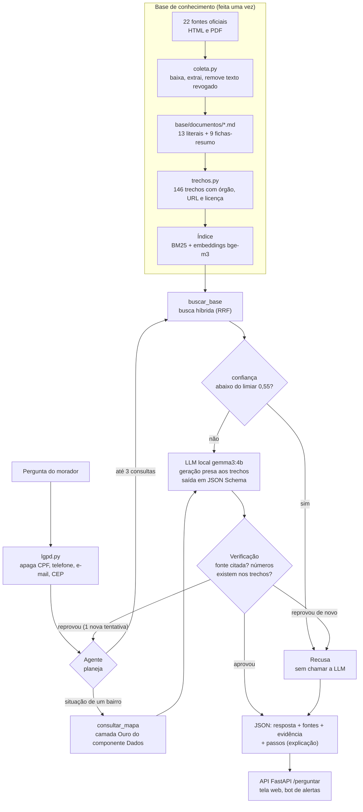
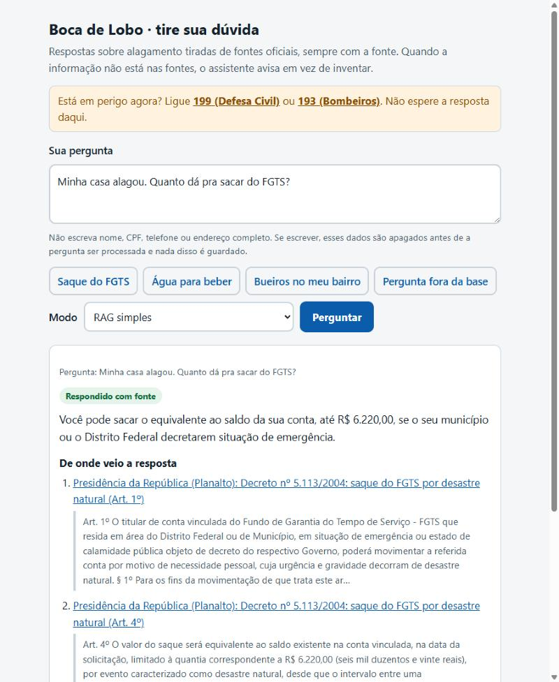

# Boca de Lobo · componente Inteligência (Generative AI for Engineering)

> **GS 2026.2 · CitizenTech · Engenharia de Software 4º ano · FIAP**

Antes de cada temporal, um robô inspeciona as bocas de lobo do bairro e descobre quais estão entupidas.
Este repositório é o **assistente do morador**: uma LLM que roda localmente e responde, **com a fonte**,
o que fazer antes, durante e depois de um alagamento e quais direitos a pessoa tem. Quando a informação
não está nas fontes oficiais, ele **recusa** em vez de inventar.

O morador pergunta *"minha rua alagou, o que eu faço com o carro?"* ou *"quanto dá pra sacar do FGTS?"*
e recebe a orientação da Defesa Civil ou o artigo do decreto, com o link.

**Relatório completo (os 7 itens pedidos): [RELATORIO.md](RELATORIO.md)**

## Integrantes

| Nome completo | RM |
|---|---|
| Açussena Macedo Mautone | 552568 |
| Felipe Heilmann Marques | 551026 |
| Felipe Voidela Toledo | 98595 |
| Carlos Eduardo Caramante Ribeiro | 552159 |
| Ian Cancian Nachtergaele | 98387 |

## Ficha técnica

| Item | Boca de Lobo |
|---|---|
| Cidadão e território | Morador de bairro que alaga todo verão, principalmente em áreas baixas e periféricas de São Paulo |
| Problema, em uma frase | Bueiro entupido + chuva forte = rua alagada, carro perdido e casa invadida, e ninguém avisa antes |
| O que a IA resolve | Na hora do alagamento o morador não sabe o que fazer, a quem pedir ajuda nem que direitos tem (saque do FGTS, isenção de IPTU, Cartão Emergencial). A informação existe, mas está espalhada em decretos e páginas de órgãos diferentes. A IA responde em linguagem simples, com a fonte, e avisa quando não sabe |
| Tema do enunciado | Segurança (emergências por enchente) |
| Componentes do produto | Robô (Maker Lab) · YOLO (Visão) · **assistente com RAG e agente (este repo)** · pipeline de dados (Big Data) · bot de alertas (RPA) · mapa público com observabilidade (DevOps) · modelo de negócio (BI) |
| Fontes de dados | 22 fontes oficiais (Defesa Civil nacional, estadual e municipal, Ministério da Saúde, Planalto, Prefeitura de São Paulo, CGE) em 146 trechos; mais o export da camada Ouro do componente Dados |
| Modelos de IA | LLM `gemma3:4b` e embeddings `bge-m3`, os dois locais (Ollama, CPU). Nenhuma API paga, nenhum dado enviado a terceiros |
| URL do MVP e repositório | Mapa do cidadão: https://felipevoidela.github.io/GS2-2026-Big-Data-Architecture/ · Este repositório: https://github.com/FelipeVoidela/GS2-2026-GENERATIVE-IA · A API e a tela do assistente rodam com `docker compose up` (a LLM é local, por isso não há URL pública gratuita; o deploy é do componente DevOps) |
| Indicadores de impacto | Acerto e alucinação medidos em 56 perguntas de teste; recusa correta do que não consta; tempo de resposta |
| ODS | 11 (cidades resilientes), 13 (adaptação ao clima), 3 (saúde) |

## Resultado

<!-- PLACAR -->

## Arquitetura do pipeline de IA



O **RAG simples** é o mesmo caminho sem o agente: uma busca com a pergunta original, 3 trechos, uma chamada à LLM.

## Estrutura do repositório

```
notebooks/                 os 5 notebooks, com as saídas salvas
  01_base_conhecimento       tarefa da IA, fontes, coleta e trechos
  02_busca_recall_limiar     casos de teste, recall@1 e recall@3, limiar de recusa
  03_geracao_rag             JSON válido, citação da fonte e recusa (sem contexto x RAG)
  04_agente                  especialização: agente com ferramentas x RAG simples
  05_placar_e_erros          placar das 3 configurações, alucinações e os 5 erros
base/                      base de conhecimento
  fontes.json                catálogo: órgão, URL, formato, licença, regra de extração
  documentos/                um .md por fonte (texto literal ou ficha-resumo)
  trechos.jsonl              os 146 trechos, cada um com fonte
  indice/                    embeddings dos trechos
avaliacao/                 teste e placar
  casos_teste.jsonl          77 perguntas com gabarito (19 "não consta")
  limiar.json                limiar de recusa calibrado
  resultados/                respostas das 3 configurações, caso a caso
  placar.md, placar.csv      placar final
src/boca_de_lobo_ia/       código
  coleta.py trechos.py       base
  busca.py                   BM25, vetorial e híbrida
  geracao.py                 LLM sem contexto e RAG simples
  agente.py mapa.py          agente e a ferramenta do mapa
  lgpd.py                    mascaramento de dados pessoais
  avaliacao.py               gabarito, recall, limiar e placar
  api.py                     API FastAPI
scripts/                   construir_base.py e avaliar.py
web/index.html             tela de conversa
tests/                     testes que rodam sem a LLM
dados/mapa_cidadao.json    cópia do export da camada Ouro (usada na avaliação e como reserva)
Dockerfile, docker-compose.yaml
```

## Como reproduzir

Pré-requisitos: Python 3.11 e Docker (ou o Ollama instalado). Cerca de 5 GB de disco para os modelos.
Tudo roda em CPU; não precisa de GPU.

### Caminho curto: só usar o assistente

```bash
docker compose up -d --build
```

Na primeira vez os modelos são baixados (4,5 GB). Depois, abra http://localhost:8000.

### Caminho completo: refazer tudo

**1. LLM local.** Suba o Ollama e baixe os dois modelos:

```bash
docker run -d --name gs-ollama -p 127.0.0.1:11434:11434 -v gs_ollama:/root/.ollama ollama/ollama
```

```bash
docker exec gs-ollama ollama pull bge-m3
```

```bash
docker exec gs-ollama ollama pull gemma3:4b
```

**2. Ambiente Python.**

```bash
python -m venv .venv
```

```bash
.venv/Scripts/python -m pip install -r requirements.txt
```

(No Linux e no macOS o executável fica em `.venv/bin/python`.)

**3. Testes que não dependem da LLM** (base, busca lexical, LGPD, regras de segurança, gabarito):

```bash
.venv/Scripts/python -m pytest -q
```

**4. Base de conhecimento.** O repositório já traz documentos, trechos e índice. Para refazer a partir das fontes oficiais:

```bash
.venv/Scripts/python scripts/construir_base.py --atualizar
```

**5. Avaliação.** Roda as 3 configurações nos 77 casos e grava cada resposta em `avaliacao/resultados/`.
Em CPU leva de 2 a 3 horas; pode ser interrompida e retomada (o que já foi respondido não é refeito).
Para refazer do zero, apague `avaliacao/resultados/`.

```bash
.venv/Scripts/python scripts/avaliar.py
```

**6. Notebooks.** Reexecuta e salva as saídas (os notebooks 03 e 04 chamam a LLM ao vivo, cerca de 10 minutos):

```bash
.venv/Scripts/python -m jupyter nbconvert --to notebook --execute --inplace --ExecutePreprocessor.timeout=3600 notebooks/*.ipynb
```

**7. API e tela.**

```bash
.venv/Scripts/python -m uvicorn boca_de_lobo_ia.api:app --app-dir src --port 8000 --no-access-log
```

Abra http://localhost:8000 (tela) ou http://localhost:8000/docs (contrato da API).

A geração usa temperatura 0 e semente fixa (42). Mesmo assim, versões diferentes do Ollama ou do
processador podem mudar uma ou outra resposta; por isso as respostas usadas no placar estão gravadas
em `avaliacao/resultados/`.

## API

| Rota | O que faz |
|---|---|
| `GET /` | tela de conversa |
| `GET /saude` | o serviço e os modelos estão prontos? |
| `GET /fontes` | catálogo da base: fonte, licença e número de trechos |
| `POST /perguntar` | `{"pergunta": "...", "modo": "agente" \| "rag" \| "sem_contexto"}` |

```bash
curl -s -X POST http://localhost:8000/perguntar -H "Content-Type: application/json" -d "{\"pergunta\": \"Minha casa alagou. Quanto posso sacar do FGTS?\", \"modo\": \"rag\"}"
```

Resposta (resumida):

```json
{
  "configuracao": "rag",
  "recusa": false,
  "resposta": "Você pode sacar o equivalente ao saldo da sua conta, até R$ 6.220,00, se o seu município decretar situação de emergência.",
  "fontes": [
    {"id": "decreto_5113#07", "orgao": "Presidência da República (Planalto)",
     "titulo": "Decreto nº 5.113/2004: saque do FGTS por desastre natural", "secao": "Art. 4º",
     "url": "https://www.planalto.gov.br/ccivil_03/_ato2004-2006/2004/decreto/d5113.htm", "texto": "Art. 4º O valor do saque será..."}
  ],
  "evidencia": "limitado à quantia correspondente a R$ 6.220,00",
  "evidencia_confere": true,
  "motivo": "respondido_com_fonte",
  "confianca": 0.627,
  "limiar": 0.55,
  "json_valido": true
}
```

Quando não consta: `"recusa": true`, `"fontes": []` e `"motivo"` igual a `abaixo_do_limiar`, `modelo_recusou`,
`resposta_sem_fonte`, `saida_invalida` ou `reprovado_na_verificacao`.



## Onde cada item da pontuação está

| Item | Onde |
|---|---|
| 01 · Tarefa da IA e casos de teste com gabarito, incluindo "não consta" | notebook 01 (tarefa) e 02 (casos); `avaliacao/casos_teste.jsonl` (77 casos, 19 "não consta") |
| 02 · Base de conhecimento, em trechos com fonte | notebook 01; `base/fontes.json`, `base/documentos/`, `base/trechos.jsonl` |
| 03 · Busca com recall@1 e recall@3 medidos e limiar justificado | notebook 02; `src/boca_de_lobo_ia/busca.py`; `avaliacao/limiar.json` |
| 04 · Geração fundamentada: JSON válido, citação da fonte e recusa | notebook 03; `geracao.py` |
| 05 · Especialização (agente) comparada ao RAG simples | notebook 04; `agente.py`, `mapa.py` |
| 06 · Placar das três configurações, com resultados interpretados | notebook 05; `avaliacao/placar.md`; RELATORIO.md, seção 5 |
| 07 · 5 erros reais com proposta de correção | notebook 05; RELATORIO.md, seção 6 |
| 08 · README e reprodutibilidade | este arquivo, `requirements.txt`, `docker-compose.yaml`, `tests/`, respostas gravadas em `avaliacao/resultados/` |

## Segurança, explicabilidade e LGPD

**Segurança**

* A LLM só fala com a API; no `docker-compose.yaml` a porta do Ollama não é publicada.
* Entrada limitada a 500 caracteres, limite de requisições por minuto e chave opcional (`API_CHAVE`, cabeçalho `X-API-Key`).
* Instrução dentro da pergunta ou de um trecho é tratada como dado (regra 7 do prompt e pergunta delimitada). Há um caso de teste só para isso (`X01`).
* Falha fechada: JSON inválido, resposta sem fonte ou reprovada na verificação vira recusa. Se a LLM cair, a API responde 503 com os telefones de emergência.
* A tela escreve tudo com `textContent`: nada do que o modelo devolve é interpretado como HTML.
* Nenhuma chave no código; a configuração vem de variáveis de ambiente (`.env.example`).

**Explicabilidade**

* Toda resposta traz os trechos citados (órgão, título, seção, URL e o texto), a frase de apoio (`evidencia`) e se ela confere com o trecho.
* `motivo`, `confianca` e `limiar` dizem por que o sistema respondeu ou recusou.
* No agente, `passos` registra cada decisão: consultas planejadas, trechos recuperados, consulta ao mapa, verificação.
* A IA não decide nada sobre o morador: orienta e aponta o canal oficial. Quem atende é uma pessoa da Defesa Civil, da Prefeitura ou do serviço de saúde.

**LGPD**

| Ponto | Como foi tratado |
|---|---|
| Finalidade e necessidade | o assistente não precisa saber quem é o morador; não há cadastro nem login |
| Dados digitados por engano | CPF, CNPJ, RG, telefone, e-mail e CEP são trocados por marcadores **antes** da busca, da LLM e do log (`lgpd.py`) |
| Compartilhamento | a pergunta não sai da infraestrutura do produto: LLM e embeddings são locais |
| Registro | o log guarda a pergunta já mascarada, a decisão e as fontes; não guarda IP nem identificador (o log de acesso do servidor fica desligado, `--no-access-log`). A pasta `logs/` não vai para o Git |
| Transparência | a tela avisa o que acontece com os dados e que a resposta é informativa |
| Base de conhecimento | só documentos públicos de órgãos oficiais; nenhum dado pessoal. O mapa consumido é a view `ouro_vw_mapa_cidadao`, que o componente Dados publica sem dado pessoal |
| Limite conhecido | nomes próprios não são detectados (exigiria um modelo de NER e erraria em nomes de rua) |

## Limitações conhecidas

* **Velocidade.** Em CPU, o RAG simples leva cerca de 25 segundos e o agente, de 1 a 2 minutos. Com GPU o mesmo código responde em poucos segundos.
* **Cobertura.** A base tem 22 fontes e cobre a cidade de São Paulo. Assuntos próximos que o morador pergunta (seguro, ressarcimento de energia, segunda via de documentos) ainda não estão nela; o sistema recusa.
* **Fichas-resumo.** 9 das 22 fontes entram como resumo escrito pela equipe, porque a página não declara licença de reprodução. O resumo foi conferido com o original, mas não é o texto oficial.
* **Juiz automático.** O acerto é medido por pontos-chave (expressões regulares). Ele não avalia redação e pode deixar passar um erro factual fora dos pontos; por isso o relatório traz também a leitura manual dos erros.
* **Conjunto de teste pequeno.** 56 casos de teste: uma diferença de 2 pontos percentuais é um caso.
* **Atualização.** Leis mudam. O decreto do FGTS já teve quatro valores; a coleta precisa ser refeita periodicamente (`construir_base.py --atualizar`).

## Outros componentes do produto

* Dados (Big Data Architecture): https://github.com/FelipeVoidela/GS2-2026-Big-Data-Architecture
* Mapa do cidadão (MVP): https://felipevoidela.github.io/GS2-2026-Big-Data-Architecture/
