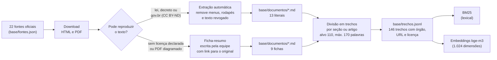
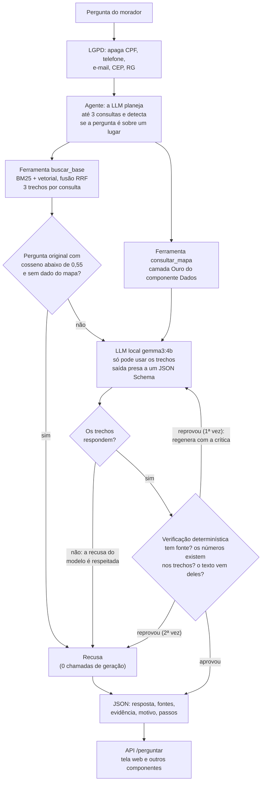

# Relatório · Generative AI for Engineering

**Boca de Lobo · assistente do morador com LLM local**
GS 2026.2 · CitizenTech · Engenharia de Software 4º ano · FIAP

Repositório: https://github.com/FelipeVoidela/GS2-2026-GENERATIVE-IA

Este relatório segue a ordem pedida no enunciado (itens 01 a 07). Tudo o que está aqui pode ser
conferido nos notebooks (com as saídas salvas) e nas respostas gravadas em `avaliacao/resultados/`.

---

## 01 · Integrantes

| Nome completo | RM |
|---|---|
| Açussena Macedo Mautone | 552568 |
| Felipe Heilmann Marques | 551026 |
| Felipe Voidela Toledo | 98595 |
| Carlos Eduardo Caramante Ribeiro | 552159 |
| Ian Cancian Nachtergaele | 98387 |

---

## 02 · Ficha técnica: o que a IA resolve

| Item | Boca de Lobo |
|---|---|
| Nome do produto | Boca de Lobo |
| Cidadão e território | Morador de bairro que alaga todo verão, principalmente em áreas baixas e periféricas de São Paulo |
| Problema, em uma frase | Bueiro entupido + chuva forte = rua alagada, carro perdido e casa invadida, e ninguém avisa antes |
| Proposta de valor | Saber antes da chuva quais bueiros estão entupidos em área de risco: a equipe de limpeza recebe a rota priorizada, e o morador sabe onde não passar e o que fazer |
| Componentes | Robô (Maker Lab) · YOLO (Visão) · **assistente com RAG e agente (este componente)** · pipeline de dados (Big Data) · bot de alertas (RPA) · mapa público com observabilidade (DevOps) · modelo de negócio (BI) |
| Fontes de dados | 22 fontes oficiais em 146 trechos (tabela do item 04) e o export da camada Ouro do componente Dados (`ouro_vw_mapa_cidadao`) |
| Modelos de IA | LLM `gemma3:4b` (Google, 4 bilhões de parâmetros, quantizada em 4 bits) e embeddings `bge-m3` (BAAI, multilíngue), os dois rodando localmente pelo Ollama, em CPU |
| URL do MVP e repositório | Mapa do cidadão: https://felipevoidela.github.io/GS2-2026-Big-Data-Architecture/ · Repositório deste componente: https://github.com/FelipeVoidela/GS2-2026-GENERATIVE-IA |
| Indicadores de impacto | Acerto e taxa de alucinação nas 56 perguntas de teste; recusa correta do que não consta; tempo de resposta |
| ODS | 11 (cidades resilientes), 13 (adaptação ao clima), 3 (saúde) |

### A tarefa da IA

**Problema do morador.** Quando a rua alaga, a pessoa precisa de respostas rápidas e certas: o que fazer com
o carro, se a água da torneira pode ser bebida, para quem ligar, se tem direito a sacar o FGTS ou a não pagar
o IPTU. Essas respostas existem, mas estão espalhadas em decretos, leis e páginas de órgãos federais, estaduais
e municipais, em linguagem que não é a do morador. Uma LLM comum responde a tudo com segurança, e erra: nos
nossos testes, o modelo sem base disse que o Cartão Emergencial paga "R$ 200 por mês" (é pagamento único de
R$ 1.000) e que não existe desconto de IPTU por alagamento (existe, por lei municipal).

**O que a IA faz.** Recebe a pergunta em texto livre e devolve um JSON com a resposta em linguagem simples,
os trechos das fontes oficiais que a sustentam (órgão, título, seção e link) e a indicação de recusa quando
a informação não consta na base.

| | |
|---|---|
| Entrada | pergunta de até 500 caracteres |
| Saída | `recusa`, `resposta`, `fontes` (trechos citados), `evidencia`, `motivo`, `confianca`, `passos` |
| Tema do enunciado | segurança (emergências por enchente) |
| Critério de sucesso | acertar mais e alucinar menos que o mesmo modelo sem contexto; recusar o que não consta; rodar integrada ao produto, de forma segura, explicável e de acordo com a LGPD |
| O que a IA não faz | não decide nada sobre o morador nem sobre a prefeitura. Ela orienta e aponta o canal oficial; quem atende é uma pessoa da Defesa Civil, da Prefeitura ou do serviço de saúde |

**Três configurações comparadas** (mesmo modelo, temperatura 0, semente fixa):

1. **LLM sem contexto**: o modelo responde de memória.
2. **RAG simples**: busca híbrida nos trechos, limiar de recusa e geração presa a 3 trechos.
3. **Agente (a especialização)**: a LLM planeja as consultas, usa duas ferramentas (busca na base e consulta ao mapa do componente Dados), verifica a resposta e, se ela for reprovada, gera de novo uma vez.

Das duas especializações que o enunciado aceita (LoRA ou agente), a equipe fez o agente: a máquina do projeto
não tem GPU NVIDIA, e os erros do RAG simples na partição de calibração eram de busca e de falta de dado, que
se resolvem com decisão e ferramentas, não com ajuste de pesos (notebook 04).

---

## 03 · Diagrama do pipeline de IA

### Dos documentos aos trechos

### Da pergunta à resposta

O **RAG simples** é o mesmo desenho sem o agente e sem a volta: uma busca com a pergunta original, 3 trechos,
o limiar, uma chamada à LLM e as regras de falha fechada (JSON inválido ou resposta sem fonte viram recusa).

**Integração com o produto.** A ferramenta `consultar_mapa` lê o JSON que o componente Dados publica
(`ouro_vw_mapa_cidadao`, o mesmo arquivo que o mapa do cidadão lê). O contrato é esse arquivo; se a URL cair,
o agente usa a cópia local e informa de que data são os dados. A API (`POST /perguntar`) é o contrato na outra
direção: a tela web deste repositório a consome, e o bot de alertas (RPA) pode usá-la para anexar a orientação
oficial ao aviso de chuva.

---

## 04 · Tabela da base: fonte, formato, licença e número de trechos

22 fontes, 146 trechos (13 fontes com texto literal, 106 trechos; 9 fichas-resumo, 40 trechos).
Acesso em 10/11/2026.

| # | Fonte | Órgão | Formato | Texto na base | Licença | Trechos |
|---|---|---|---|---|---|---|
| 1 | [Chuvas intensas: saiba como agir](https://www.gov.br/mdr/pt-br/assuntos/protecao-e-defesa-civil/informacoes-uteis/centro-nacional-de-gerenciamento-de-riscos-e-desastres-cenad/chuvasintensas.pdf) | Secretaria Nacional de Proteção e Defesa Civil (MIDR) | PDF | literal | CC BY-ND 3.0 (padrão do portal gov.br) | 3 |
| 2 | [Defesa Civil Alerta](https://www.gov.br/mdr/pt-br/assuntos/protecao-e-defesa-civil/defesa-civil-alerta) | Ministério da Integração e do Desenvolvimento Regional (MIDR) | HTML | literal | CC BY-ND 3.0 (rodapé da página) | 27 |
| 3 | [Protocolo de emergência climática: inundações, enchentes e alagamentos](https://www.gov.br/mma/pt-br/centrais-de-conteudo/publicacoes/educacao-ambiental/protocolo-inundacoes.pdf) | Ministério do Meio Ambiente e Mudança do Clima (MMA) | PDF | ficha | Reprodução sem fins lucrativos permitida, citada a fonte; virou ficha porque o PDF é diagramado | 8 |
| 4 | [Enchentes: cuidados com a saúde](https://www.gov.br/saude/pt-br/assuntos/saude-de-a-a-z/e/enchentes) | Ministério da Saúde | HTML | literal | CC BY-ND 3.0 (rodapé da página) | 5 |
| 5 | [Enchentes: cuidados com a água](https://www.gov.br/saude/pt-br/assuntos/saude-de-a-a-z/e/enchentes/cuidados-com-a-agua) | Ministério da Saúde | HTML | literal | CC BY-ND 3.0 (rodapé da página) | 3 |
| 6 | [Enchentes: cuidados com os alimentos](https://www.gov.br/saude/pt-br/assuntos/saude-de-a-a-z/e/enchentes/cuidados-com-os-alimentos) | Ministério da Saúde | HTML | literal | CC BY-ND 3.0 (rodapé da página) | 2 |
| 7 | [Enchentes: cuidados com a leptospirose](https://www.gov.br/saude/pt-br/assuntos/saude-de-a-a-z/e/enchentes/cuidados-com-a-leptospirose) | Ministério da Saúde | HTML | literal | CC BY-ND 3.0 (rodapé da página) | 1 |
| 8 | [Enchentes: cuidados com o risco de tétano](https://www.gov.br/saude/pt-br/assuntos/saude-de-a-a-z/e/enchentes/cuidados-com-risco-de-tetano) | Ministério da Saúde | HTML | literal | CC BY-ND 3.0 (rodapé da página) | 2 |
| 9 | [Enchentes: cuidados com animais peçonhentos](https://www.gov.br/saude/pt-br/assuntos/saude-de-a-a-z/e/enchentes/cuidados-com-animais-peconhentos) | Ministério da Saúde | HTML | literal | CC BY-ND 3.0 (rodapé da página) | 2 |
| 10 | [Lei nº 12.608/2012: Política Nacional de Proteção e Defesa Civil](https://www.planalto.gov.br/ccivil_03/_ato2011-2014/2012/lei/l12608.htm) (arts. 1º, 2º, 8º e 9º) | Presidência da República (Planalto) | HTML | literal | Ato oficial, sem proteção autoral (Lei 9.610/98, art. 8º, IV) | 13 |
| 11 | [Decreto nº 5.113/2004: saque do FGTS por desastre natural](https://www.planalto.gov.br/ccivil_03/_ato2004-2006/2004/decreto/d5113.htm) | Presidência da República (Planalto) | HTML | literal | Ato oficial, sem proteção autoral | 11 |
| 12 | [Lei municipal nº 14.493/2007: isenção de IPTU para imóveis atingidos por enchentes](https://legislacao.prefeitura.sp.gov.br/leis/lei-14493-de-9-de-agosto-de-2007) | Prefeitura de São Paulo (Catálogo de Legislação) | HTML | literal | Ato oficial, sem proteção autoral | 12 |
| 13 | [Decreto municipal nº 48.767/2007: regulamenta a isenção de IPTU por enchente](https://legislacao.prefeitura.sp.gov.br/leis/decreto-48767-de-27-de-setembro-de-2007) | Prefeitura de São Paulo (Catálogo de Legislação) | HTML | literal | Ato oficial, sem proteção autoral | 16 |
| 14 | [Lei municipal nº 17.759/2022: altera a isenção de IPTU por enchente](https://legislacao.prefeitura.sp.gov.br/leis/lei-17759-de-15-de-marco-de-2022) | Prefeitura de São Paulo (Catálogo de Legislação) | HTML | literal | Ato oficial, sem proteção autoral | 9 |
| 15 | [Chuvas excessivas: saiba como agir](https://prefeitura.sp.gov.br/web/defesa_civil/w/cuidados_importantes/179951) | Defesa Civil da Prefeitura de São Paulo | HTML | ficha | Não declarada na página | 6 |
| 16 | [Dicas para o período de chuvas](https://www.cgesp.org/v3/dicas.jsp) | CGE (Prefeitura de São Paulo) | HTML | ficha | Não declarada na página | 4 |
| 17 | [Operação Chuvas de Verão e estados de criticidade](https://www.cgesp.org/v3/operacao-chuvas-de-verao.jsp) | CGE (Prefeitura de São Paulo) | HTML | ficha | Não declarada na página | 3 |
| 18 | [SP Sempre Alerta: alertas por SMS (40199)](https://www.spsemprealerta.sp.gov.br/) | Defesa Civil do Estado de São Paulo | HTML | ficha | Direitos reservados ao Governo do Estado | 3 |
| 19 | [Imóveis afetados por enchentes: benefício fiscal no IPTU](https://prefeitura.sp.gov.br/web/fazenda/w/servicos/iptu/4212) | Secretaria Municipal da Fazenda de São Paulo | HTML | ficha | Não declarada na página | 4 |
| 20 | [Manutenção e limpeza de bocas de lobo, galerias e ramais](https://prefeitura.sp.gov.br/web/ipiranga/w/zeladoria_urbana/68044) | Prefeitura de São Paulo (Subprefeituras) | HTML | ficha | Não declarada na página | 2 |
| 21 | [Cartão Emergencial para famílias afetadas por desastres](https://prefeitura.sp.gov.br/web/habitacao/w/cart%C3%A3o-emergencial-garante-apoio-imediato-a-fam%C3%ADlias-afetadas-por-desastres-naturais) | Secretaria Municipal de Habitação (SEHAB) | HTML | ficha | Não declarada na página | 2 |
| 22 | [Cuidados básicos em relação às enchentes (folder)](https://www.prefeitura.sp.gov.br/cidade/secretarias/upload/saude/vigilancia_em_saude/Folder%20_enchentes%20vers%C3%A3o_2023_V2.pdf) | Secretaria Municipal da Saúde de São Paulo | PDF | ficha | Não declarada no documento | 8 |

**Literal x ficha.** Só entra como texto literal o que pode ser reproduzido: leis e decretos (atos oficiais não
têm proteção autoral) e páginas do portal gov.br (licença CC BY-ND 3.0, com a fonte citada). Onde a página não
declara licença, a equipe escreveu uma **ficha-resumo** com os fatos (valores, prazos, telefones, passos) e o
link para o original. A ficha é marcada como tal no documento, no trecho e na resposta da API (`tipo_texto`).

**Cuidados na extração** (notebook 01):

* as páginas do Planalto mantêm as redações antigas riscadas. No decreto do FGTS o limite do saque aparece
  quatro vezes (R$ 2.600, R$ 4.650, R$ 5.400 e o vigente, R$ 6.220). A extração descarta o texto riscado e um
  teste automático (`tests/test_nucleo.py`) garante que os valores revogados não estão na base;
* as fontes às vezes divergem (tempo de espera da água com hipoclorito: 30 minutos no Ministério da Saúde,
  10 minutos no folder da Secretaria Municipal da Saúde). A base guarda as duas orientações, cada uma com seu
  órgão, e o prompt manda informar as duas.

**Conjunto de teste.** `avaliacao/casos_teste.jsonl` tem 77 perguntas escritas em linguagem de morador, cada
uma com resposta esperada, pontos-chave e os trechos que a contêm. 18 são "não consta" (a resposta certa é
recusar), 6 pedem dado do mapa e 1 traz uma instrução maliciosa. 21 casos formam a partição **dev** (escolha
do modo de busca, calibração do limiar e ajuste dos prompts) e 56 a partição de **teste** (só o placar).

---

## 05 · Performance do modelo para as configurações testadas

Modelo `gemma3:4b` local, temperatura 0, semente 42, nas três configurações. Todas as respostas estão
gravadas em `avaliacao/resultados/`; o placar é gerado por `scripts/gerar_placar.py` (`avaliacao/placar.md`)
e analisado no notebook 05.

### 5.1 Busca (notebook 02)

Medida nos casos cuja resposta está em algum trecho da base (14 na partição dev, 39 no teste).

| Modo de busca | recall@1 (dev) | recall@3 (dev) | recall@1 (teste) | recall@3 (teste) | recall@5 (teste) | MRR (teste) |
|---|---|---|---|---|---|---|
| BM25 (lexical) | 0,714 | 0,857 | 0,641 | 0,744 | 0,769 | 0,690 |
| Vetorial (`bge-m3`) | 0,786 | 0,929 | 0,769 | 0,974 | 1,000 | 0,864 |
| **Híbrida (adotada)**, RRF com peso vetorial 0,6 | **0,857** | **1,000** | **0,641** | **0,846** | **0,949** | **0,759** |

A busca híbrida foi escolhida na partição dev, onde foi a melhor. **No teste a escolha não se confirmou**: a
busca vetorial pura recuperou melhor. A partição dev tinha 14 casos de busca, e um caso a mais ou a menos muda o
recall em 7 pontos; era pouco para escolher. O sistema avaliado manteve a híbrida, porque trocar depois de ver
o teste seria ajustar o sistema ao gabarito; a troca está proposta como correção do erro 2.

**Limiar de recusa.** A confiança de uma pergunta é a maior similaridade de cosseno entre ela e qualquer trecho.
Abaixo do limiar, o sistema recusa sem chamar a LLM. O limiar ficou em **0,55**: a menor confiança de uma
pergunta respondível da partição dev (0,583) menos uma margem de 0,03. A justificativa tem três partes:

1. o limiar separa bem o que está fora do assunto, mas perguntas do mesmo assunto que a base não responde
   (seguro do carro, prazo do 156) ficam misturadas com as respondíveis, e nenhum limiar as separa;
2. os dois erros não custam o mesmo: barrar uma pergunta respondível deixa o morador sem orientação; deixar
   passar uma que não consta ainda encontra a segunda barreira, que é a regra de recusa na geração;
3. por isso o limiar fica abaixo de todas as respondíveis da calibração.

No teste, o limiar recusou sem gastar LLM 8 das 12 perguntas que não constam, e barrou 3 das 39 respondíveis
(7,7%). A margem, calibrada com 14 perguntas, ficou curta (erro 1).

### 5.2 Placar das três configurações (teste, 56 casos)

| Configuração | Acerto | Alucinação | Recusa indevida | Recusa no "não consta" | Citação correta | JSON válido | Chamadas à LLM |
|---|---|---|---|---|---|---|---|
| 1. LLM sem contexto | 30,4% | 60,7% | 4,5% | 33,3% | 0,0% | 100% | 1,0 |
| 2. RAG simples | 76,8% | 5,4% | 22,7% | 100% | 90,6% | 100% | 0,7 |
| 3. Agente (especialização) | **85,7%** | 7,1% | 6,8% | 91,7% | 85,0% | 100% | 1,8 |

Em número de casos:

| Veredito | Sem contexto | RAG simples | Agente |
|---|---|---|---|
| correta | 11 | 29 | 36 |
| recusa correta | 6 | 14 | 12 |
| parcial | 3 | 0 | 1 |
| recusa indevida | 2 | 10 | 3 |
| incorreta | 26 | 3 | 3 |
| alucinação (respondeu o que não consta) | 8 | 0 | 1 |

* **Acerto**: corretas mais recusas corretas, sobre o total.
* **Alucinação**: incorretas mais respostas a perguntas que não constam, isto é, toda resposta errada que
  chegou ao morador.
* **Recusa indevida**: sobre os 44 casos respondíveis. **Recusa no "não consta"**: sobre os 12 que não constam.
* **Citação correta**: entre as respostas dadas a casos respondíveis, quantas citam um trecho do gabarito.

### 5.3 Interpretação

**O objetivo do enunciado foi atingido.** O mesmo modelo, sem treino adicional, acerta mais e alucina menos
quando responde com a base:

* **Sem contexto**, acerta 17 de 56 e entrega resposta errada ou inventada em 34. Quase nunca diz "não sei":
  das 12 perguntas que não constam, recusou 4. Onde mais erra é em **direitos** (2 acertos em 12), que são
  perguntas de número exato: valor, prazo, percentual.
* **RAG simples** leva o acerto a 76,8% e derruba a alucinação de 60,7% para 5,4% (11 vezes menos). Recusou
  as 12 perguntas que não constam. O preço é a cautela: 10 recusas indevidas, sendo 5 perguntas sobre bairros
  (que ele não tem como responder), 3 barradas pelo limiar e 2 por falha da busca.
* **Agente** chega a 85,7%. Em relação ao RAG, ganhou 6 perguntas (4 respondidas com o mapa do componente
  Dados e 2 em que a consulta planejada trouxe o trecho que faltava) e perdeu 1 (respondeu uma pergunta que
  não consta). A alucinação subiu de 3 para 4 casos.

**De onde vem o ganho do agente.** Sem as 5 perguntas que dependem do mapa, o agente acerta 44 de 51 (86,3%)
e o RAG, 43 de 51 (84,3%), com os mesmos 3 erros entregues cada. O ganho do agente vem quase todo da
ferramenta do mapa; nas perguntas respondidas só com documentos os dois praticamente empatam, e o agente
custa o dobro de chamadas.

| Categoria (teste) | Casos | Sem contexto | RAG simples | Agente |
|---|---|---|---|---|
| orientação | 14 | 57,1% | 71,4% | 78,6% |
| alertas e serviços | 7 | 14,3% | 71,4% | 85,7% |
| direitos | 12 | 16,7% | 91,7% | 91,7% |
| multi (dois assuntos) | 5 | 20,0% | 80,0% | 80,0% |
| não consta | 12 | 33,3% | 100% | 91,7% |
| produto (mapa) | 5 | 0,0% | 0,0% | 80,0% |
| segurança (instrução maliciosa) | 1 | 100% | 100% | 100% |

**Custo.** Tempo medido à parte, com 12 perguntas da partição dev, uma por vez (`scripts/medir_tempos.py`), em
um AMD Ryzen 5 5600X sem GPU:

| Configuração | Tempo mediano | Percentil 90 | Chamadas à LLM |
|---|---|---|---|
| 1. LLM sem contexto | 12,6 s | 15,3 s | 1 |
| 2. RAG simples | 27,1 s | 29,7 s | 1 (0 quando o limiar recusa) |
| 3. Agente | 36,3 s | 42,6 s | 2 |

É lento para uma conversa, e é a principal limitação do protótipo. A tela mantém os telefones 199 e 193
visíveis enquanto a resposta é gerada.

**O que o placar não mostra.**

* São 56 casos de teste: cada caso vale 1,8 ponto. A distância entre o modelo sem contexto e os outros dois é
  grande demais para ser acaso; a distância entre RAG e agente (5 acertos, 1 erro) deve ser lida como tendência.
* O juiz é automático (pontos-chave por expressão regular) e foi auditado: as respostas foram lidas uma a uma,
  9 padrões foram corrigidos e um caso teve o gabarito trocado porque o agente estava certo. Cada ajuste está
  em `avaliacao/AUDITORIA.md`, com quem ele favoreceu. O juiz continua sem ver erro fora dos pontos-chave, o
  que favorece o modelo sem contexto: o acerto dele é um teto.
* A verificação determinística do agente não reprovou nenhuma resposta no teste: nenhum número inventado
  apareceu nas respostas dele. Ela mostrou serviço na partição dev e teria pego o erro 4 se estivesse no RAG.

### 5.4 Demonstração de alucinações

Perguntas de teste, com a resposta do modelo sem contexto como saiu (`avaliacao/resultados/sem_contexto.jsonl`):

| Pergunta | Sem contexto | O que a fonte diz | RAG e agente |
|---|---|---|---|
| Para qual número mando o SMS de alerta? | mandar "ALERTA SP" para o **136** | mandar o CEP para o 40199 | certos, citando a ficha da Defesa Civil do Estado |
| A geladeira ficou com água até a metade. Posso ligar? | "**Ligue a geladeira**, mas observe se o problema persiste" | não usar equipamento elétrico molhado: risco de choque e curto-circuito | recusaram (erro 1: barrada pelo limiar) |
| Qual o valor máximo da isenção de IPTU? | "até **80% do IPTU**" | R$ 20.000,00 por exercício e por imóvel | certos, citando a lei municipal |
| Até que data a subprefeitura manda o relatório? | "até o dia **31 de julho**" | até 30 de novembro | certos |
| Quanto vale o Cartão Emergencial e qual o limite do FGTS? | cartão "gratuito"; FGTS "até **30% do seu saldo**" | R$ 1.000 e R$ 6.220,00 | certos |
| Qual a multa por jogar entulho no bueiro? | "entre **R$ 293,46 e R$ 5.969,48**" | não consta na base | recusaram, como devem |

Três padrões se repetem: **número exato inventado** (valor, percentual, data, telefone), **fonte inventada**
(nomes genéricos de órgãos e endereços de página que não existem) e **conselho perigoso** (ligar a geladeira
que ficou na água). Na partição dev o modelo sem contexto também disse que o Cartão Emergencial paga "R$ 200
por mês" e trocou telefones de emergência ("192, Defesa Civil").

O RAG não zerou a alucinação: em duas respostas ele completou a orientação com "Defesa Civil (193)", telefone
que não estava em nenhum trecho recuperado (erro 4).

### 5.5 Como o agente chegou ao desenho final

O agente passou por quatro rodadas na partição dev antes de responder qualquer pergunta de teste. As respostas
de cada rodada estão em `avaliacao/historico/` e a tabela completa, no notebook 04.

| Rodada | O que apareceu na dev | Correção |
|---|---|---|
| 1 | JSON cortado virava recusa; condição do trecho ("só no alerta extremo") sumia da resposta | limite de saída maior e nova tentativa; regra 8 do prompt |
| 1 e 2 | o agente errava pergunta que o RAG acertava: 5 trechos parecidos confundem o modelo de 4B | contexto enxuto: os 3 trechos do RAG mais só o que falta |
| 2 | a verificação reprovou uma resposta certa escrita com outras palavras | a verificação só bloqueia número sem apoio |
| 3 | "12 meses" reprovado porque o decreto escreve "doze meses"; insistir depois da recusa do modelo gerou uma alucinação | números por extenso; a recusa do modelo é respeitada e o limiar olha a pergunta original |

---

## 06 · Os 5 erros, a causa e a correção proposta

Cinco erros reais da partição de teste, lidos nas respostas gravadas. O notebook 05 mostra cada resposta como
saiu, com os trechos recuperados e os passos do agente.

### Erro 1 · O limiar barrou uma pergunta que a base responde (RAG e agente)

* **Pergunta (S28):** "A geladeira ficou com água até a metade. Posso ligar ela de novo?"
* **O que saiu:** recusa, com motivo `abaixo_do_limiar` (confiança 0,515; limiar 0,55).
* **Causa:** a pergunta fala em "geladeira" e "ligar de novo"; o trecho que responde fala em "equipamentos
  elétricos que foram molhados". A similaridade ficou abaixo do limiar, calibrado com 14 perguntas e margem de
  0,03. No teste, 3 das 39 respondíveis caíram abaixo dele (S13, S25 e S28).
* **Correção proposta:** baixar o limiar para 0,50. Com esse valor nenhuma respondível do teste seria barrada
  e metade das que não constam continuaria sendo recusada sem gastar LLM; as outras ficam para a regra de
  recusa do prompt, que no RAG recusou as 4 que passaram do limiar. Como o número foi lido no teste, precisa
  ser validado em perguntas novas. Em paralelo, incluir nas fichas os termos do dia a dia ("geladeira", "TV")
  ao lado do termo oficial.
* **Por que é um erro tolerável:** na mesma pergunta, o modelo sem contexto mandou ligar a geladeira.

### Erro 2 · A busca trouxe a pergunta vizinha do FAQ (RAG e agente)

* **Pergunta (S16):** "Quais celulares conseguem receber o Defesa Civil Alerta?"
* **O que saiu:** os nomes da configuração no Android e no iOS, citando um trecho real. A resposta certa
  (aparelhos lançados a partir de 2020) está em outra pergunta do mesmo FAQ.
* **Causa:** o FAQ do Defesa Civil Alerta tem 27 trechos que repetem "Defesa Civil Alerta", "celular" e
  "receber". O BM25 não distingue um do outro e, na fusão, rebaixa o trecho que a busca vetorial tinha posto
  em 3º lugar para o 6º. No agente, a consulta planejada trouxe o trecho certo em 3º, mas só o primeiro
  trecho de cada consulta entra no contexto.
* **Correção proposta:** busca vetorial pura ou peso vetorial maior (recall@3 de 0,974 contra 0,846 no teste),
  escolhida com validação cruzada sobre todos os casos de busca e não com 14; em fontes de FAQ, indexar a
  pergunta com mais peso que a resposta; no agente, acrescentar o primeiro trecho **ainda não presente** de
  cada consulta planejada.

### Erro 3 · O parágrafo certo ficou num trecho sem contexto (RAG e agente)

* **Pergunta (D02):** "Até quando eu posso pedir o saque do FGTS depois do desastre?"
* **O que saiu:** RAG: sem prazo, falando do intervalo de 12 meses entre saques. Agente: "até 12 meses após a
  declaração do desastre". O certo é 90 dias depois da portaria de reconhecimento.
* **Causa:** o prazo está no § 3º do art. 1º do decreto. O artigo passou do tamanho máximo e foi cortado em
  dois trechos; o segundo começa em "§ 2º A movimentação da conta vinculada de que trata o caput...", sem
  dizer que é sobre o saque do FGTS, e ficou em 5º na busca. Sem ele, o modelo usou os números do artigo
  vizinho. A verificação do agente aprovou: ela confere se o número existe nos trechos, não se ele responde à
  pergunta.
* **Correção proposta:** na divisão em trechos, repetir o caput do artigo no início de cada pedaço; no agente,
  a mesma correção do erro 2; no prompt, um caso de recusa parcial ("o prazo não consta") para quando a
  pergunta pede um prazo e nenhum trecho traz prazo para aquilo.

### Erro 4 · Telefone inventado para completar a resposta (RAG simples)

* **Pergunta (M06):** "O que significa estado de alerta do CGE e pra quem eu ligo se o córrego aqui do lado
  transbordar?"
* **O que saiu:** "ligue para a Defesa Civil (193) ou para o CGE (193)". O 193 é dos Bombeiros.
* **Causa:** a pergunta tem dois assuntos e a busca única trouxe três trechos sobre o primeiro, nenhum com
  telefone. O modelo completou de memória. A regra 5 do prompt proíbe, mas é uma instrução, não uma garantia.
  O agente, na mesma pergunta, respondeu "ligue para a Defesa Civil" sem inventar número (parcial).
* **Correção proposta:** levar para o RAG simples a verificação de números do agente (`numeros_sem_apoio`),
  que é determinística, não custa chamada à LLM e teria reprovado o "193"; no agente, garantir um trecho por
  consulta planejada, para a segunda parte da pergunta ter de onde sair.

### Erro 5 · A ferramenta do mapa: dado lido errado e ferramenta acionada sem necessidade (agente)

* **Pergunta (P03):** "Tem algum ponto com aviso de evitar a área no Capão Redondo?" O mapa diz 0 pontos com
  "Evite a área" e 7 com "Atenção". O agente respondeu "sim" e listou quatro ruas.
* **Pergunta (N04):** "Qual o endereço do abrigo mais perto da minha casa na Vila Mariana?" Não consta. O
  agente respondeu com orientações gerais sobre abrigos.
* **Causa:** em P03, o texto que a ferramenta devolve tem a contagem, a explicação do aviso e uma lista de
  "pontos que mais preocupam"; o modelo juntou a lista com o nome do aviso, e a verificação aprovou porque os
  nomes das ruas existem no dado. Em N04, o planejador viu "Vila Mariana" e acionou o mapa; com um dado do
  mapa em mãos, o limiar deixou de valer (o RAG tinha recusado por ele), os trechos da base entraram junto e
  o modelo respondeu algo que não é falso, mas não é o que foi perguntado.
* **Correção proposta:** a ferramenta devolver frases fechadas ("nenhum ponto do Capão Redondo está com aviso
  Evite a área") e a verificação conferir contra o JSON do mapa; quando a pergunta original está abaixo do
  limiar, entregar ao modelo só o dado do mapa; orientar o planejador a preencher o local só quando a
  pergunta é sobre bueiro, alagamento ou risco.

---

## 07 · Conclusão técnica e links

1. **A base muda o comportamento do modelo.** O mesmo `gemma3:4b`, sem treino adicional, passa de 30,4% de
   acerto e 60,7% de respostas erradas para 76,8% e 5,4% quando responde só com os trechos, cita a fonte e
   pode recusar.
2. **A recusa é o que segura a alucinação.** O RAG recusou as 12 perguntas de teste que não constam; o modelo
   sem contexto respondeu 8. O custo é deixar sem resposta algumas perguntas respondíveis, um erro mais
   seguro que o oposto.
3. **O agente vale pelo que só ele alcança.** Chegou a 85,7% de acerto, e o ganho veio da ferramenta do mapa
   (integração com o componente Dados) e de duas perguntas recuperadas pela consulta planejada. Nas perguntas
   respondidas só com documentos ele empata com o RAG e custa o dobro de chamadas.
4. **Os erros que restam são de engenharia de busca e de dados, não do modelo:** limiar calibrado com poucos
   casos, fusão híbrida pior que a vetorial pura, trechos de lei cortados sem o caput, texto da ferramenta
   ambíguo. Todos têm correção proposta e nenhum exige um modelo maior.
5. **Segurança, explicabilidade e LGPD estão no desenho, não em um anexo:** LLM e embeddings locais (a pergunta
   não sai da infraestrutura), dados pessoais apagados antes da busca e do log, saída em JSON de formato fixo,
   falha fechada (sem fonte, não responde), e cada resposta acompanhada dos trechos, do motivo e dos passos.
   A IA orienta; quem decide e atende é uma pessoa da Defesa Civil, da Prefeitura ou do serviço de saúde.

**Limitações.** Conjunto de teste pequeno (56 casos); juiz automático; 9 das 22 fontes entram como
ficha-resumo; base restrita à cidade de São Paulo; respostas de 30 a 40 segundos em CPU.

**Próximos passos.** Validar as cinco correções em perguntas novas (o teste já foi visto), ampliar a base com
os assuntos que os moradores perguntam e ela não cobre (seguro, ressarcimento de energia, segunda via de
documentos) e testar com moradores se a resposta é entendida.

### Links

| | |
|---|---|
| Repositório deste componente | https://github.com/FelipeVoidela/GS2-2026-GENERATIVE-IA |
| Vídeo | **a incluir pela equipe antes da entrega** |
| Notebooks (com saídas) | [01 base](notebooks/01_base_conhecimento.ipynb) · [02 busca](notebooks/02_busca_recall_limiar.ipynb) · [03 geração](notebooks/03_geracao_rag.ipynb) · [04 agente](notebooks/04_agente.ipynb) · [05 placar e erros](notebooks/05_placar_e_erros.ipynb) |
| Placar e auditoria | [avaliacao/placar.md](avaliacao/placar.md) · [avaliacao/AUDITORIA.md](avaliacao/AUDITORIA.md) |
| Como reproduzir | [README.md](README.md) |
| Componente Dados (Big Data) | https://github.com/FelipeVoidela/GS2-2026-Big-Data-Architecture |
| Mapa do cidadão (MVP) | https://felipevoidela.github.io/GS2-2026-Big-Data-Architecture/ |
