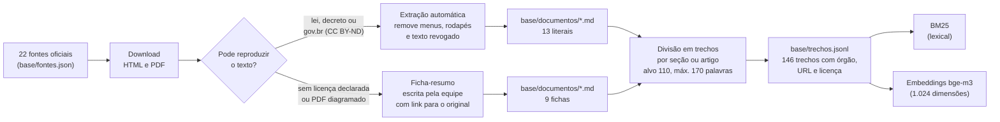
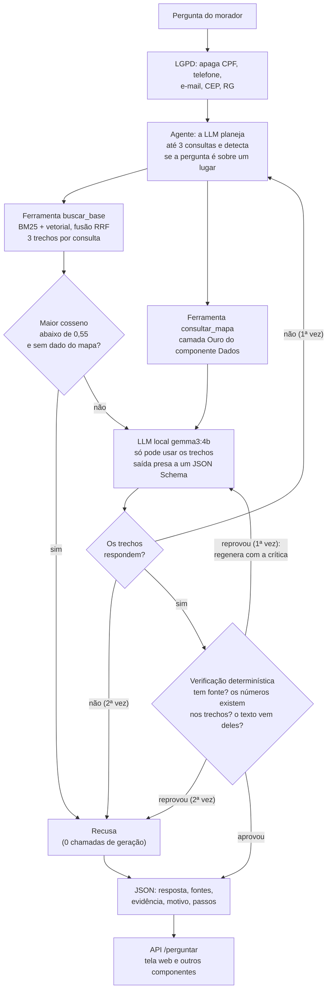

# Relatório · Generative AI for Engineering

**Boca de Lobo · assistente do morador com LLM local**
GS 2026.2 · CitizenTech · Engenharia de Software 4º ano · FIAP

Repositório: https://github.com/FelipeVoidela/GS2-2026-GENERATIVE-IA

Este relatório segue a ordem pedida no enunciado (itens 01 a 07). Tudo o que está aqui pode ser
conferido nos notebooks (com as saídas salvas) e nas respostas gravadas em `avaliacao/resultados/`.

---

## 01 · Integrantes

| Nome completo | RM |
|---|---|
| Açussena Macedo Mautone | 552568 |
| Felipe Heilmann Marques | 551026 |
| Felipe Voidela Toledo | 98595 |
| Carlos Eduardo Caramante Ribeiro | 552159 |
| Ian Cancian Nachtergaele | 98387 |

---

## 02 · Ficha técnica: o que a IA resolve

| Item | Boca de Lobo |
|---|---|
| Nome do produto | Boca de Lobo |
| Cidadão e território | Morador de bairro que alaga todo verão, principalmente em áreas baixas e periféricas de São Paulo |
| Problema, em uma frase | Bueiro entupido + chuva forte = rua alagada, carro perdido e casa invadida, e ninguém avisa antes |
| Proposta de valor | Saber antes da chuva quais bueiros estão entupidos em área de risco: a equipe de limpeza recebe a rota priorizada, e o morador sabe onde não passar e o que fazer |
| Componentes | Robô (Maker Lab) · YOLO (Visão) · **assistente com RAG e agente (este componente)** · pipeline de dados (Big Data) · bot de alertas (RPA) · mapa público com observabilidade (DevOps) · modelo de negócio (BI) |
| Fontes de dados | 22 fontes oficiais em 146 trechos (tabela do item 04) e o export da camada Ouro do componente Dados (`ouro_vw_mapa_cidadao`) |
| Modelos de IA | LLM `gemma3:4b` (Google, 4 bilhões de parâmetros, quantizada em 4 bits) e embeddings `bge-m3` (BAAI, multilíngue), os dois rodando localmente pelo Ollama, em CPU |
| URL do MVP e repositório | Mapa do cidadão: https://felipevoidela.github.io/GS2-2026-Big-Data-Architecture/ · Repositório deste componente: https://github.com/FelipeVoidela/GS2-2026-GENERATIVE-IA |
| Indicadores de impacto | Acerto e taxa de alucinação nas 56 perguntas de teste; recusa correta do que não consta; tempo de resposta |
| ODS | 11 (cidades resilientes), 13 (adaptação ao clima), 3 (saúde) |

### A tarefa da IA

**Problema do morador.** Quando a rua alaga, a pessoa precisa de respostas rápidas e certas: o que fazer com
o carro, se a água da torneira pode ser bebida, para quem ligar, se tem direito a sacar o FGTS ou a não pagar
o IPTU. Essas respostas existem, mas estão espalhadas em decretos, leis e páginas de órgãos federais, estaduais
e municipais, em linguagem que não é a do morador. Uma LLM comum responde a tudo com segurança, e erra: nos
nossos testes, o modelo sem base disse que o Cartão Emergencial paga "R$ 200 por mês" (é pagamento único de
R$ 1.000) e que não existe desconto de IPTU por alagamento (existe, por lei municipal).

**O que a IA faz.** Recebe a pergunta em texto livre e devolve um JSON com a resposta em linguagem simples,
os trechos das fontes oficiais que a sustentam (órgão, título, seção e link) e a indicação de recusa quando
a informação não consta na base.

| | |
|---|---|
| Entrada | pergunta de até 500 caracteres |
| Saída | `recusa`, `resposta`, `fontes` (trechos citados), `evidencia`, `motivo`, `confianca`, `passos` |
| Tema do enunciado | segurança (emergências por enchente) |
| Critério de sucesso | acertar mais e alucinar menos que o mesmo modelo sem contexto; recusar o que não consta; rodar integrada ao produto, de forma segura, explicável e de acordo com a LGPD |
| O que a IA não faz | não decide nada sobre o morador nem sobre a prefeitura. Ela orienta e aponta o canal oficial; quem atende é uma pessoa da Defesa Civil, da Prefeitura ou do serviço de saúde |

**Três configurações comparadas** (mesmo modelo, temperatura 0, semente fixa):

1. **LLM sem contexto**: o modelo responde de memória.
2. **RAG simples**: busca híbrida nos trechos, limiar de recusa e geração presa a 3 trechos.
3. **Agente (a especialização)**: a LLM planeja as consultas, usa duas ferramentas (busca na base e consulta ao mapa do componente Dados), verifica a resposta e tem uma segunda rodada.

Das duas especializações que o enunciado aceita (LoRA ou agente), a equipe fez o agente: a máquina do projeto
não tem GPU NVIDIA, e os erros do RAG simples na partição de calibração eram de busca e de falta de dado, que
se resolvem com decisão e ferramentas, não com ajuste de pesos (notebook 04).

---

## 03 · Diagrama do pipeline de IA

### Dos documentos aos trechos

### Da pergunta à resposta

O **RAG simples** é o mesmo desenho sem o agente e sem a volta: uma busca com a pergunta original, 3 trechos,
o limiar, uma chamada à LLM e as regras de falha fechada (JSON inválido ou resposta sem fonte viram recusa).

**Integração com o produto.** A ferramenta `consultar_mapa` lê o JSON que o componente Dados publica
(`ouro_vw_mapa_cidadao`, o mesmo arquivo que o mapa do cidadão lê). O contrato é esse arquivo; se a URL cair,
o agente usa a cópia local e informa de que data são os dados. A API (`POST /perguntar`) é o contrato na outra
direção: a tela web deste repositório a consome, e o bot de alertas (RPA) pode usá-la para anexar a orientação
oficial ao aviso de chuva.

---

## 04 · Tabela da base: fonte, formato, licença e número de trechos

22 fontes, 146 trechos (13 fontes com texto literal, 106 trechos; 9 fichas-resumo, 40 trechos).
Acesso em 10/11/2026.

| # | Fonte | Órgão | Formato | Texto na base | Licença | Trechos |
|---|---|---|---|---|---|---|
| 1 | [Chuvas intensas: saiba como agir](https://www.gov.br/mdr/pt-br/assuntos/protecao-e-defesa-civil/informacoes-uteis/centro-nacional-de-gerenciamento-de-riscos-e-desastres-cenad/chuvasintensas.pdf) | Secretaria Nacional de Proteção e Defesa Civil (MIDR) | PDF | literal | CC BY-ND 3.0 (padrão do portal gov.br) | 3 |
| 2 | [Defesa Civil Alerta](https://www.gov.br/mdr/pt-br/assuntos/protecao-e-defesa-civil/defesa-civil-alerta) | Ministério da Integração e do Desenvolvimento Regional (MIDR) | HTML | literal | CC BY-ND 3.0 (rodapé da página) | 27 |
| 3 | [Protocolo de emergência climática: inundações, enchentes e alagamentos](https://www.gov.br/mma/pt-br/centrais-de-conteudo/publicacoes/educacao-ambiental/protocolo-inundacoes.pdf) | Ministério do Meio Ambiente e Mudança do Clima (MMA) | PDF | ficha | Reprodução sem fins lucrativos permitida, citada a fonte; virou ficha porque o PDF é diagramado | 8 |
| 4 | [Enchentes: cuidados com a saúde](https://www.gov.br/saude/pt-br/assuntos/saude-de-a-a-z/e/enchentes) | Ministério da Saúde | HTML | literal | CC BY-ND 3.0 (rodapé da página) | 5 |
| 5 | [Enchentes: cuidados com a água](https://www.gov.br/saude/pt-br/assuntos/saude-de-a-a-z/e/enchentes/cuidados-com-a-agua) | Ministério da Saúde | HTML | literal | CC BY-ND 3.0 (rodapé da página) | 3 |
| 6 | [Enchentes: cuidados com os alimentos](https://www.gov.br/saude/pt-br/assuntos/saude-de-a-a-z/e/enchentes/cuidados-com-os-alimentos) | Ministério da Saúde | HTML | literal | CC BY-ND 3.0 (rodapé da página) | 2 |
| 7 | [Enchentes: cuidados com a leptospirose](https://www.gov.br/saude/pt-br/assuntos/saude-de-a-a-z/e/enchentes/cuidados-com-a-leptospirose) | Ministério da Saúde | HTML | literal | CC BY-ND 3.0 (rodapé da página) | 1 |
| 8 | [Enchentes: cuidados com o risco de tétano](https://www.gov.br/saude/pt-br/assuntos/saude-de-a-a-z/e/enchentes/cuidados-com-risco-de-tetano) | Ministério da Saúde | HTML | literal | CC BY-ND 3.0 (rodapé da página) | 2 |
| 9 | [Enchentes: cuidados com animais peçonhentos](https://www.gov.br/saude/pt-br/assuntos/saude-de-a-a-z/e/enchentes/cuidados-com-animais-peconhentos) | Ministério da Saúde | HTML | literal | CC BY-ND 3.0 (rodapé da página) | 2 |
| 10 | [Lei nº 12.608/2012: Política Nacional de Proteção e Defesa Civil](https://www.planalto.gov.br/ccivil_03/_ato2011-2014/2012/lei/l12608.htm) (arts. 1º, 2º, 8º e 9º) | Presidência da República (Planalto) | HTML | literal | Ato oficial, sem proteção autoral (Lei 9.610/98, art. 8º, IV) | 13 |
| 11 | [Decreto nº 5.113/2004: saque do FGTS por desastre natural](https://www.planalto.gov.br/ccivil_03/_ato2004-2006/2004/decreto/d5113.htm) | Presidência da República (Planalto) | HTML | literal | Ato oficial, sem proteção autoral | 11 |
| 12 | [Lei municipal nº 14.493/2007: isenção de IPTU para imóveis atingidos por enchentes](https://legislacao.prefeitura.sp.gov.br/leis/lei-14493-de-9-de-agosto-de-2007) | Prefeitura de São Paulo (Catálogo de Legislação) | HTML | literal | Ato oficial, sem proteção autoral | 12 |
| 13 | [Decreto municipal nº 48.767/2007: regulamenta a isenção de IPTU por enchente](https://legislacao.prefeitura.sp.gov.br/leis/decreto-48767-de-27-de-setembro-de-2007) | Prefeitura de São Paulo (Catálogo de Legislação) | HTML | literal | Ato oficial, sem proteção autoral | 16 |
| 14 | [Lei municipal nº 17.759/2022: altera a isenção de IPTU por enchente](https://legislacao.prefeitura.sp.gov.br/leis/lei-17759-de-15-de-marco-de-2022) | Prefeitura de São Paulo (Catálogo de Legislação) | HTML | literal | Ato oficial, sem proteção autoral | 9 |
| 15 | [Chuvas excessivas: saiba como agir](https://prefeitura.sp.gov.br/web/defesa_civil/w/cuidados_importantes/179951) | Defesa Civil da Prefeitura de São Paulo | HTML | ficha | Não declarada na página | 6 |
| 16 | [Dicas para o período de chuvas](https://www.cgesp.org/v3/dicas.jsp) | CGE (Prefeitura de São Paulo) | HTML | ficha | Não declarada na página | 4 |
| 17 | [Operação Chuvas de Verão e estados de criticidade](https://www.cgesp.org/v3/operacao-chuvas-de-verao.jsp) | CGE (Prefeitura de São Paulo) | HTML | ficha | Não declarada na página | 3 |
| 18 | [SP Sempre Alerta: alertas por SMS (40199)](https://www.spsemprealerta.sp.gov.br/) | Defesa Civil do Estado de São Paulo | HTML | ficha | Direitos reservados ao Governo do Estado | 3 |
| 19 | [Imóveis afetados por enchentes: benefício fiscal no IPTU](https://prefeitura.sp.gov.br/web/fazenda/w/servicos/iptu/4212) | Secretaria Municipal da Fazenda de São Paulo | HTML | ficha | Não declarada na página | 4 |
| 20 | [Manutenção e limpeza de bocas de lobo, galerias e ramais](https://prefeitura.sp.gov.br/web/ipiranga/w/zeladoria_urbana/68044) | Prefeitura de São Paulo (Subprefeituras) | HTML | ficha | Não declarada na página | 2 |
| 21 | [Cartão Emergencial para famílias afetadas por desastres](https://prefeitura.sp.gov.br/web/habitacao/w/cart%C3%A3o-emergencial-garante-apoio-imediato-a-fam%C3%ADlias-afetadas-por-desastres-naturais) | Secretaria Municipal de Habitação (SEHAB) | HTML | ficha | Não declarada na página | 2 |
| 22 | [Cuidados básicos em relação às enchentes (folder)](https://www.prefeitura.sp.gov.br/cidade/secretarias/upload/saude/vigilancia_em_saude/Folder%20_enchentes%20vers%C3%A3o_2023_V2.pdf) | Secretaria Municipal da Saúde de São Paulo | PDF | ficha | Não declarada no documento | 8 |

**Literal x ficha.** Só entra como texto literal o que pode ser reproduzido: leis e decretos (atos oficiais não
têm proteção autoral) e páginas do portal gov.br (licença CC BY-ND 3.0, com a fonte citada). Onde a página não
declara licença, a equipe escreveu uma **ficha-resumo** com os fatos (valores, prazos, telefones, passos) e o
link para o original. A ficha é marcada como tal no documento, no trecho e na resposta da API (`tipo_texto`).

**Cuidados na extração** (notebook 01):

* as páginas do Planalto mantêm as redações antigas riscadas. No decreto do FGTS o limite do saque aparece
  quatro vezes (R$ 2.600, R$ 4.650, R$ 5.400 e o vigente, R$ 6.220). A extração descarta o texto riscado e um
  teste automático (`tests/test_nucleo.py`) garante que os valores revogados não estão na base;
* as fontes às vezes divergem (tempo de espera da água com hipoclorito: 30 minutos no Ministério da Saúde,
  10 minutos no folder da Secretaria Municipal da Saúde). A base guarda as duas orientações, cada uma com seu
  órgão, e o prompt manda informar as duas.

**Conjunto de teste.** `avaliacao/casos_teste.jsonl` tem 77 perguntas escritas em linguagem de morador, cada
uma com resposta esperada, pontos-chave e os trechos que a contêm. 19 são "não consta" (a resposta certa é
recusar), 6 pedem dado do mapa e 1 traz uma instrução maliciosa. 21 casos formam a partição **dev** (escolha
do modo de busca, calibração do limiar e ajuste dos prompts) e 56 a partição de **teste** (só o placar).

---

<!-- SECAO5 -->
